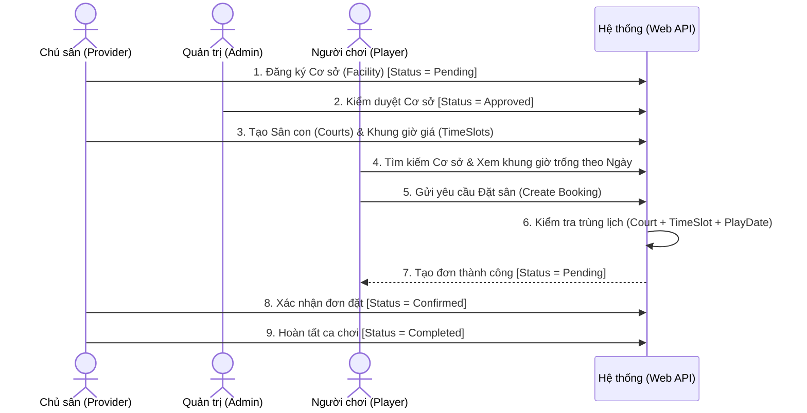

# TÀI LIỆU ĐẶC TẢ NGHIỆP VỤ (BUSINESS DEFINITION)
**Dự án:** Hệ thống Đặt sân Cầu lông Đa nhà cung cấp (Multi-Provider Badminton Court Booking System)  
**Môn học:** PRN232 - Building Cross-Platform Back-End Application With .NET

---

## 1. Tổng quan Hệ thống (System Overview)

Hệ thống là nền tảng trung gian (Marketplace Platform) kết nối giữa **nhiều Chủ sân cầu lông (Providers)** và **nhiều Người chơi (Players/Consumers)**, được điều phối và kiểm duyệt bởi **Quản trị viên hệ thống (System Admin)**.

Hệ thống bao gồm **3 phân hệ giao diện (3 Sites)** giao tiếp với một **Centralized ASP.NET Core Web API** duy nhất:
1. **Player Site (Consumer Site):** Dành cho người chơi tìm kiếm cụm sân, xem lịch trống, đặt sân và quản lý lịch sử đặt.
2. **Provider Site (Owner Site):** Dành cho các chủ sân đăng ký cơ sở cầu lông, quản lý sân con, cấu hình khung giờ/giá cả và xử lý đơn đặt sân của khách.
3. **Admin Site (Management Site):** Dành cho quản trị viên nền tảng quản lý người dùng, phê duyệt cơ sở cầu lông của Provider và giám sát toàn hệ thống.

---

## 2. Phân quyền và Tác nhân (Actors & Roles)

| Vai trò (Role) | Phân hệ truy cập | Mô tả trách nhiệm chính |
| :--- | :--- | :--- |
| **Guest** (Chưa đăng nhập) | Player Site | Xem danh sách cơ sở đã duyệt, lọc/tìm kiếm sân, xem chi tiết sân & khung giờ, Đăng ký / Đăng nhập. |
| **Player** (`Player`) | Player Site | Kế thừa quyền của Guest; Kiểm tra lịch trống, Đặt sân (Booking), Xem lịch sử đặt sân cá nhân, Hủy đơn khi còn ở trạng thái chờ. |
| **Provider** (`Provider`) | Provider Site | Đăng ký và quản lý Cơ sở cầu lông (`Facility`), Quản lý Sân con (`Court`), Quản lý Khung giờ & Giá (`TimeSlot`), Duyệt/Hủy/Hoàn thành Đơn đặt sân (`Booking`) tại cơ sở của mình, Xuất báo cáo đơn đặt sân. |
| **Admin** (`Admin`) | Admin Site | Quản lý danh sách tài khoản (`User`), Khóa/Mở khóa tài khoản, Phê duyệt hoặc Đình chỉ Cơ sở cầu lông (`Facility`) của Provider, Xem thống kê toàn hệ thống. |

---

## 3. Đặc tả Chức năng theo 3 Phân hệ (Functional Requirements by Site)

### 3.1. Phân hệ Người chơi (Player Site)
* **UC-P01: Đăng ký & Đăng nhập tài khoản Player**
  * Người chơi đăng ký tài khoản mới với vai trò `Player` hoặc đăng nhập để nhận phiên đăng nhập (JWT lưu trong cookie HttpOnly).
* **UC-P02: Tìm kiếm, Lọc và Sắp xếp Cơ sở cầu lông (Ứng dụng OData)**
  * Tìm kiếm cơ sở theo tên, quận/huyện (`District`), lọc theo mức giá, sắp xếp theo tên hoặc ngày tạo.
  * Chỉ hiển thị các cơ sở có trạng thái `Approved`.
* **UC-P03: Xem chi tiết Cơ sở, Sân con và Khung giờ trống**
  * Xem thông tin chi tiết của một cơ sở, danh sách các sân con (`Court`) đang `Active`, và bảng giá các khung giờ (`TimeSlot`).
  * Chọn ngày chơi (`PlayDate`) để xem các ca còn trống hoặc đã có người đặt.
* **UC-P04: Đặt sân cầu lông (Create Booking)**
  * Chọn Cơ sở $\rightarrow$ Chọn Ngày chơi (`PlayDate`) $\rightarrow$ Chọn Sân con (`Court`) & Khung giờ (`TimeSlot`).
  * Hệ thống kiểm tra trùng lịch và tạo đơn ở trạng thái `Pending`, tự động lưu `TotalPrice` theo giá của `TimeSlot`.
* **UC-P05: Quản lý Lịch sử đặt sân & Hủy đơn**
  * Xem danh sách các đơn đặt sân của chính mình, lọc theo trạng thái hoặc ngày chơi.
  * Hủy đơn đặt sân nếu đơn đang ở trạng thái `Pending`.

### 3.2. Phân hệ Chủ sân (Provider Site)
* **UC-V01: Đăng ký & Quản lý Cơ sở cầu lông (`Facility`)**
  * Provider tạo mới cơ sở cầu lông (Tên cụm sân, Địa chỉ, Quận/Huyện, SĐT, Giờ mở/đóng cửa, Mô tả). Mặc định trạng thái ban đầu là `Pending` chờ Admin duyệt.
  * Cập nhật thông tin hoặc xóa cơ sở thuộc quyền sở hữu của mình.
* **UC-V02: Quản lý Sân con (`Court`)**
  * Thêm, sửa, xóa, xem danh sách các sân con (VD: Sân 1, Sân 2, Sân VIP) thuộc cơ sở của mình.
  * Chuyển đổi trạng thái sân giữa `Active` (Đang hoạt động) và `Maintenance` (Đang bảo trì).
* **UC-V03: Quản lý Khung giờ & Bảng giá (`TimeSlot`)**
  * Thiết lập các ca chơi trong ngày cho cơ sở (VD: 06:00 - 08:00 giá 80.000đ; 18:00 - 20:00 giá 140.000đ).
  * Thêm, sửa, xóa khung giờ thuộc cơ sở của mình.
* **UC-V04: Quản lý Đơn đặt sân tại Cơ sở (`Booking Management`)**
  * Xem danh sách toàn bộ đơn đặt sân của khách hàng tại các cơ sở do mình làm chủ (hỗ trợ lọc theo ngày, trạng thái, sân bằng OData).
  * Cập nhật trạng thái đơn: Xác nhận (`Confirmed`), Từ chối/Hủy (`Cancelled`), Hoàn thành (`Completed`).
* **UC-V05: Xuất dữ liệu Đơn đặt sân (Ứng dụng Content Negotiation / Media Formatter)**
  * Xuất danh sách đơn đặt sân ra định dạng CSV / XML / JSON để đối soát doanh thu.

### 3.3. Phân hệ Quản trị viên (Admin Site)
* **UC-A01: Quản lý Người dùng (`User Management`)**
  * Xem toàn bộ danh sách người dùng (`Admin`, `Provider`, `Player`), lọc/tìm kiếm qua OData.
  * Tạo tài khoản mới, cập nhật thông tin, khóa/mở khóa tài khoản (`IsActive`), phân quyền Role.
* **UC-A02: Kiểm duyệt Cơ sở cầu lông (`Facility Approval`)**
  * Xem danh sách các cơ sở cầu lông do các Provider đăng ký.
  * Duyệt (`Approved`) để cơ sở được phép hiển thị trên Player Site, hoặc Từ chối/Đình chỉ (`Rejected` / `Suspended`).
* **UC-A03: Giám sát & Thống kê toàn sàn (`System Dashboard`)**
  * Xem tổng quan số lượng người dùng, số lượng chủ sân, số cơ sở đang hoạt động và tổng số đơn đặt sân trên toàn hệ thống.

---

## 4. Đặc tả Thực thể Nghiệp vụ Cốt lõi (Core Business Entities)

Hệ thống được chuẩn hóa với **5 thực thể nghiệp vụ chính**:

1. **`User` (Người dùng)**
   * Lưu trữ thông tin định danh và phân quyền cho cả 3 nhóm: `Admin`, `Provider`, `Player`.
   * Thuộc tính chính: `Id`, `FullName`, `Email`, `PhoneNumber`, `PasswordHash`, `Role`, `IsActive`, `CreatedAt`.

2. **`Facility` (Cơ sở / Cụm sân cầu lông)**
   * Đại diện cho một địa điểm kinh doanh sân cầu lông thuộc sở hữu của một `Provider`.
   * Thuộc tính chính: `Id`, `ProviderId` (FK $\rightarrow$ `User`), `Name`, `Address`, `District`, `Phone`, `Description`, `OpenTime`, `CloseTime`, `Status` (`Pending`, `Approved`, `Rejected`, `Suspended`), `CreatedAt`.

3. **`Court` (Sân cầu lông con)**
   * Đại diện cho từng sân vật lý bên trong một `Facility` (VD: Sân số 1, Sân số 2).
   * Thuộc tính chính: `Id`, `FacilityId` (FK $\rightarrow$ `Facility`), `CourtName`, `CourtType` (`PVC`, `Wooden`, `Acrylic`), `Status` (`Active`, `Maintenance`).

4. **`TimeSlot` (Khung giờ & Bảng giá)**
   * Đại diện cho các khung giờ cho thuê và mức giá tương ứng tại một `Facility`.
   * Thuộc tính chính: `Id`, `FacilityId` (FK $\rightarrow$ `Facility`), `SlotName` (VD: "Ca sáng 1", "Ca tối giờ vàng"), `StartTime`, `EndTime`, `Price`, `IsActive`.

5. **`Booking` (Đơn đặt sân)**
   * Ghi nhận giao dịch đặt một `Court` cụ thể vào một `TimeSlot` cụ thể trong ngày `PlayDate` của một `Player`.
   * Thuộc tính chính: `Id`, `PlayerId` (FK $\rightarrow$ `User`), `CourtId` (FK $\rightarrow$ `Court`), `TimeSlotId` (FK $\rightarrow$ `TimeSlot`), `PlayDate`, `TotalPrice`, `Status` (`Pending`, `Confirmed`, `Cancelled`, `Completed`), `Note`, `CreatedAt`.

---

## 5. Luồng Nghiệp vụ Chính (Core Business Workflows)

---

## 6. Quy tắc Nghiệp vụ & Ràng buộc (Business Rules)

1. **BR-01 (Cô lập dữ liệu Chủ sân - Multi-tenant Isolation):**
   * Một `Provider` chỉ được xem, thêm, sửa, xóa `Facility`, `Court`, `TimeSlot` và quản lý các `Booking` thuộc những `Facility` do chính `Provider` đó sở hữu.
2. **BR-02 (Điều kiện hiển thị và đặt sân):**
   * Người chơi chỉ có thể tìm thấy và đặt sân tại các `Facility` có trạng thái `Approved`, `Court` có trạng thái `Active`, và `TimeSlot` có `IsActive = true`.
3. **BR-03 (Chống đặt trùng lịch - Anti Double-Booking):**
   * Tại cùng một `CourtId`, cùng một `TimeSlotId` và cùng một ngày `PlayDate`, hệ thống **không cho phép** tồn tại nhiều hơn một đơn `Booking` đang ở trạng thái `Pending` hoặc `Confirmed`. (Nếu đơn trước đó đã `Cancelled` thì người khác được phép đặt lại).
4. **BR-04 (Ràng buộc thời gian hợp lệ):**
   * Ngày đặt chơi (`PlayDate`) phải lớn hơn hoặc bằng ngày hiện tại ($\ge \text{Today}$).
   * Trong `TimeSlot`, giờ kết thúc (`EndTime`) bắt buộc phải lớn hơn giờ bắt đầu (`StartTime`).
   * `CourtId` và `TimeSlotId` trong cùng một `Booking` bắt buộc phải thuộc cùng một `FacilityId`.
5. **BR-05 (Quy tắc chuyển trạng thái Booking):**
   * `Player` chỉ được phép chuyển trạng thái đơn của mình từ `Pending` $\rightarrow$ `Cancelled`.
   * `Provider` được phép chuyển trạng thái đơn tại cơ sở của mình:
     * `Pending` $\rightarrow$ `Confirmed` hoặc `Cancelled`.
     * `Confirmed` $\rightarrow$ `Completed` hoặc `Cancelled`.
   * Đơn đã ở trạng thái `Cancelled` hoặc `Completed` là trạng thái cuối, không thể chỉnh sửa trạng thái được nữa.

