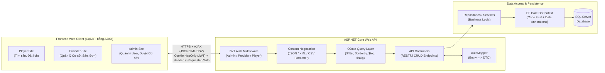
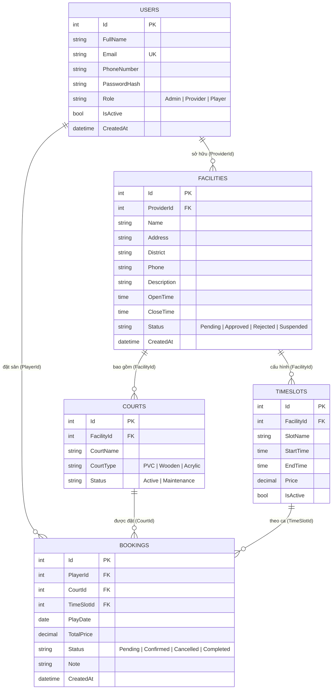

# TÀI LIỆU ĐẶC TẢ KỸ THUẬT (TECHNICAL DEFINITION)
**Dự án:** Hệ thống Đặt sân Cầu lông Đa nhà cung cấp (Multi-Provider Badminton Court Booking System)  
**Môn học:** PRN232 - Building Cross-Platform Back-End Application With .NET

---

## 1. Kiến trúc Hệ thống & Công nghệ Sử dụng (System Architecture & Tech Stack)

### 1.1. Công nghệ sử dụng
* **Framework Backend:** ASP.NET Core Web API (.NET 8.0)
* **ORM & Database:** Entity Framework Core (Code First) + SQL Server
* **Truy vấn nâng cao:** `Microsoft.AspNetCore.OData` (v8.x)
* **Ánh xạ đối tượng:** `AutoMapper`
* **Xác thực & Phân quyền:** `Microsoft.AspNetCore.Authentication.JwtBearer` (JWT Role-based Authorization: `Admin`, `Provider`, `Player`)
* **Định dạng dữ liệu (Content Negotiation):** JSON (mặc định), XML (`AddXmlSerializerFormatters()`), và Custom CSV Media Formatter (`TextOutputFormatter`).
* **Frontend (3 Sites gọi API bằng AJAX):** ASP.NET Core Razor Pages / MVC (hoặc HTML5 + Bootstrap 5 + jQuery AJAX / Fetch API) chia thành 3 khu vực: `/player`, `/provider`, `/admin`.

### 1.2. Sơ đồ Kiến trúc Tổng thể



### 1.3. Cấu trúc Solution (Clean N-Tier Architecture)
```text
BadmintonBookingSystem.sln
├── src/
│   ├── BadmintonBooking.Domain/          # Entities, Enums, Data Annotations
│   ├── BadmintonBooking.DAL/             # AppDbContext, Migrations, Repositories
│   ├── BadmintonBooking.BLL/             # Services, DTOs, AutoMapper Profiles, Custom Validations
│   ├── BadmintonBooking.WebAPI/          # Controllers, OData Config, JWT Config, Custom CSV Formatter
│   └── BadmintonBooking.WebClient/       # Giao diện 3 Sites (Player, Provider, Admin) gọi API bằng AJAX
└── docs/
    ├── 01-business-definition.md
    └── 02-technical-definition.md
```

---

## 2. Thiết kế Cơ sở dữ liệu (EF Core Code First & ERD)

### 2.1. Sơ đồ Quan hệ Thực thể (ERD)



### 2.2. Thiết kế Entities & Data Annotations (Code First)

Sử dụng đầy đủ các `Data Annotations` trong namespace `System.ComponentModel.DataAnnotations` và `System.ComponentModel.DataAnnotations.Schema` theo đúng yêu cầu đề bài:

* **`User.cs`**
  * `[Key]`, `[DatabaseGenerated(DatabaseGeneratedOption.Identity)]` cho `Id`.
  * `[Required(ErrorMessage = "Họ tên không được để trống")]`, `[StringLength(100, MinimumLength = 2)]` cho `FullName`.
  * `[Required]`, `[EmailAddress]`, `[MaxLength(150)]` cho `Email`.
  * `[Required]`, `[Phone]`, `[RegularExpression(@"^(0[3|5|7|8|9])+([0-9]{8})$")]` cho `PhoneNumber`.
  * `[Required]`, `[RegularExpression("^(Admin|Provider|Player)$")]` cho `Role`.

* **`Facility.cs`**
  * `[Key]` cho `Id`.
  * `[Required]`, `[ForeignKey(nameof(Provider))]` cho `ProviderId`.
  * `[Required]`, `[StringLength(150, MinimumLength = 5)]` cho `Name`.
  * `[Required]`, `[StringLength(250)]` cho `Address`.
  * `[Required]`, `[StringLength(100)]` cho `District`.
  * `[Required]`, `[Phone]` cho `Phone`.

* **`Court.cs`**
  * `[Key]` cho `Id`.
  * `[Required]`, `[ForeignKey(nameof(Facility))]` cho `FacilityId`.
  * `[Required]`, `[StringLength(50)]` cho `CourtName`.
  * `[Required]`, `[RegularExpression("^(PVC|Wooden|Acrylic)$")]` cho `CourtType`.
  * `[Required]`, `[RegularExpression("^(Active|Maintenance)$")]` cho `Status`.

* **`TimeSlot.cs`**
  * `[Key]` cho `Id`.
  * `[Required]`, `[ForeignKey(nameof(Facility))]` cho `FacilityId`.
  * `[Required]`, `[StringLength(50)]` cho `SlotName`.
  * `[Required]`, `[DataType(DataType.Time)]` cho `StartTime` và `EndTime`.
  * `[Required]`, `[Range(10000, 5000000, ErrorMessage = "Giá ca phải từ 10.000đ đến 5.000.000đ")]`, `[Column(TypeName = "decimal(18,2)")]` cho `Price`.

* **`Booking.cs`**
  * `[Key]` cho `Id`.
  * `[Required]` cho `PlayerId`, `CourtId`, `TimeSlotId`.
  * `[Required]`, `[DataType(DataType.Date)]` cho `PlayDate`.
  * `[Range(0, 10000000)]`, `[Column(TypeName = "decimal(18,2)")]` cho `TotalPrice`.
  * `[MaxLength(500)]` cho `Note`.

* **Lưu ý cấu hình Fluent API trong `AppDbContext.OnModelCreating`:**
  * Thiết lập `DeleteBehavior.Restrict` cho các khóa ngoại dẫn tới `Booking` (`PlayerId`, `CourtId`, `TimeSlotId`) để tránh lỗi *Multiple Cascade Paths* trên SQL Server.
  * Tạo Unique Index chống đặt trùng lịch hoặc kiểm tra ở tầng Business Service.

---

## 3. Thiết kế RESTful Web API (Đáp ứng > 5 API chuẩn CRUD)

Mỗi Resource chính (`Facilities`, `Courts`, `TimeSlots`, `Bookings`, `Users`) đều cung cấp đầy đủ 5 phương thức chuẩn: **`GET all`**, **`GET by id`**, **`POST`**, **`PUT`**, **`DELETE`**.

### 3.1. Nhóm API Xác thực (`AuthController`)
| Method | Endpoint | Quyền | Mô tả |
| :--- | :--- | :--- | :--- |
| `POST` | `/api/auth/register` | Public | Đăng ký tài khoản (`Player` hoặc `Provider`). |
| `POST` | `/api/auth/login` | Public (giới hạn 10 lần/phút/IP) | Đăng nhập. JWT được đặt vào cookie `courtside_token` (HttpOnly, Secure, SameSite=Lax, 24 giờ). Body trả về `UserId`, `FullName`, `Email`, `Role`; trường `accessToken` luôn rỗng. |
| `POST` | `/api/auth/logout` | Public | Xóa cookie xác thực. |
| `GET` | `/api/auth/me` | Authenticated | Lấy thông tin người dùng hiện tại từ JWT Claims. |

Mọi request thay đổi dữ liệu (`POST`, `PUT`, `PATCH`, `DELETE`) phải gửi kèm header `X-Requested-With: CourtSideWeb`, thiếu header trả về `403`. Xem thêm mục 4.4.

### 3.x. Nhóm API Ví & Thanh toán (`WalletController`)
| Method | Endpoint | Quyền | Mô tả |
| :--- | :--- | :--- | :--- |
| `GET` | `/api/wallet/me` | Authenticated | Số dư và thông tin ví của người dùng hiện tại. |
| `GET` | `/api/wallet/transactions` | Authenticated | Lịch sử giao dịch ví của người dùng hiện tại. |
| `POST` | `/api/wallet/topup` | Authenticated | Tạo giao dịch nạp tiền `Pending` và mã VietQR. |
| `GET` | `/api/wallet/admin/pending-topups` | `Admin` | Danh sách giao dịch nạp đang chờ đối soát. |
| `POST` | `/api/payments/{code}/confirm` | `Admin` (nạp ví) | Xác nhận đã nhận tiền theo mã đơn, cộng số dư ví. Endpoint `confirm-topup` cũ đã bỏ. |
| `POST` | `/api/payments/{code}/reject` | `Admin`, `Provider` (đơn của cơ sở) | Từ chối đơn chờ. Với nạp ví, đơn đóng và giao dịch nạp bị hủy, không cộng tiền. |
| `POST` | `/api/wallet/pay-booking` | Authenticated (chủ đơn) | Thanh toán đơn đặt sân bằng số dư ví, đơn chuyển sang `Confirmed`. |

Chi tiết quy tắc tiền và đối soát xem `docs/04-thanh-toan-va-bao-mat.md`.

### 3.2. Nhóm API Cơ sở cầu lông (`FacilitiesController`) — *Hỗ trợ OData*
| Method | Endpoint | Quyền | Mô tả |
| :--- | :--- | :--- | :--- |
| `GET` | `/api/facilities` | Public / All | **[GET ALL + OData]** Lấy danh sách cơ sở (`$filter`, `$orderby`, `$top`, `$skip`). |
| `GET` | `/api/facilities/{id}` | Public / All | **[GET BY ID]** Lấy chi tiết 1 cơ sở kèm danh sách sân & khung giờ. |
| `POST` | `/api/facilities` | `Provider` | **[POST]** Provider tạo cơ sở mới (`Status = Pending`). |
| `PUT` | `/api/facilities/{id}` | `Provider`, `Admin` | **[PUT]** Provider cập nhật thông tin cơ sở của mình. |
| `PATCH` | `/api/facilities/{id}/status` | `Admin` | Admin duyệt (`Approved`) hoặc đình chỉ (`Suspended`) cơ sở. |
| `DELETE` | `/api/facilities/{id}` | `Provider`, `Admin` | **[DELETE]** Xóa cơ sở (nếu chưa phát sinh đơn đặt đang hoạt động). |

### 3.3. Nhóm API Sân con (`CourtsController`) — *Hỗ trợ OData*
| Method | Endpoint | Quyền | Mô tả |
| :--- | :--- | :--- | :--- |
| `GET` | `/api/courts` | Public / All | **[GET ALL + OData]** Lấy danh sách sân (lọc theo `FacilityId`, `Status`, `CourtType`). |
| `GET` | `/api/courts/{id}` | Public / All | **[GET BY ID]** Xem chi tiết 1 sân cầu lông. |
| `POST` | `/api/courts` | `Provider` | **[POST]** Thêm sân con mới vào cơ sở của Provider. |
| `PUT` | `/api/courts/{id}` | `Provider` | **[PUT]** Cập nhật tên sân, loại sân, trạng thái bảo trì. |
| `DELETE` | `/api/courts/{id}` | `Provider` | **[DELETE]** Xóa sân con. |

### 3.4. Nhóm API Khung giờ & Giá (`TimeSlotsController`) — *Hỗ trợ OData*
| Method | Endpoint | Quyền | Mô tả |
| :--- | :--- | :--- | :--- |
| `GET` | `/api/timeslots` | Public / All | **[GET ALL + OData]** Lấy danh sách khung giờ (lọc theo `FacilityId`, khoảng `Price`). |
| `GET` | `/api/timeslots/{id}` | Public / All | **[GET BY ID]** Lấy chi tiết 1 khung giờ. |
| `GET` | `/api/timeslots/available` | Public / All | Kiểm tra các khung giờ còn trống theo `facilityId`, `courtId`, `playDate`. |
| `POST` | `/api/timeslots` | `Provider` | **[POST]** Tạo khung giờ & giá mới cho cơ sở. |
| `PUT` | `/api/timeslots/{id}` | `Provider` | **[PUT]** Cập nhật giờ bắt đầu/kết thúc hoặc giá ca. |
| `DELETE` | `/api/timeslots/{id}` | `Provider` | **[DELETE]** Xóa khung giờ. |

### 3.5. Nhóm API Đặt sân (`BookingsController`) — *Hỗ trợ OData & Content Negotiation (JSON/XML/CSV)*
| Method | Endpoint | Quyền | Mô tả |
| :--- | :--- | :--- | :--- |
| `GET` | `/api/bookings` | `Admin`, `Provider`, `Player` | **[GET ALL + OData + CSV/XML/JSON]** Lấy danh sách đơn (Player thấy đơn của mình; Provider thấy đơn tại cơ sở của mình; Admin thấy toàn bộ). |
| `GET` | `/api/bookings/{id}` | `Admin`, `Provider`, `Player` | **[GET BY ID]** Xem chi tiết 1 đơn đặt sân. |
| `POST` | `/api/bookings` | `Player` | **[POST]** Đặt sân mới (Validate trùng lịch, tính `TotalPrice`). |
| `PUT` | `/api/bookings/{id}` | `Provider`, `Player`, `Admin` | **[PUT]** Cập nhật ghi chú hoặc đổi trạng thái. Provider chỉ duyệt (`Pending` → `Confirmed`) hoặc từ chối đơn chờ; đơn `Confirmed` không hủy và không chuyển tay sang `Completed` (hệ thống tự hoàn thành). Player chỉ hủy đơn `Pending`. |
| `DELETE` | `/api/bookings/{id}` | `Admin`, `Player` | **[DELETE]** Xóa đơn đặt sân (chỉ cho phép khi đơn ở trạng thái `Pending` hoặc `Cancelled`). |

### 3.6. Nhóm API Quản trị Người dùng (`UsersController`) — *Hỗ trợ OData*
| Method | Endpoint | Quyền | Mô tả |
| :--- | :--- | :--- | :--- |
| `GET` | `/api/users` | `Admin` | **[GET ALL + OData]** Lấy danh sách người dùng toàn hệ thống. |
| `GET` | `/api/users/{id}` | `Admin` | **[GET BY ID]** Xem chi tiết tài khoản. |
| `POST` | `/api/users` | `Admin` | **[POST]** Admin tạo tài khoản mới. |
| `PUT` | `/api/users/{id}` | `Admin` | **[PUT]** Cập nhật Role hoặc trạng thái `IsActive`. |
| `DELETE` | `/api/users/{id}` | `Admin` | **[DELETE]** Xóa/vô hiệu hóa tài khoản. |

---

## 4. Đặc tả Triển khai Các Yêu cầu Kỹ thuật Bắt buộc

### 4.1. Tích hợp OData (`Microsoft.AspNetCore.OData`)
* Cấu hình trong `Program.cs`:
  ```csharp
  builder.Services.AddControllers()
      .AddOData(options => options
          .Select()
          .Filter()
          .OrderBy()
          .Expand()
          .Count()
          .SetMaxTop(100));
  ```
* Gắn `[EnableQuery]` lên các action `GET` của `FacilitiesController`, `CourtsController`, `TimeSlotsController`, `BookingsController`, `UsersController`.
* **Ví dụ các truy vấn OData thực tế trên Frontend AJAX:**
  * Lọc cơ sở đã duyệt tại Quận Cầu Giấy:
    `GET /api/facilities?$filter=Status eq 'Approved' and contains(District, 'Cầu Giấy')&$orderby=Name asc`
  * Lọc khung giờ có giá dưới 120.000đ:
    `GET /api/timeslots?$filter=FacilityId eq 2 and Price le 120000&$orderby=StartTime asc`
  * Lọc đơn đặt sân của Provider theo ngày chơi:
    `GET /api/bookings?$filter=PlayDate eq 2026-11-10 and Status eq 'Confirmed'&$orderby=CreatedAt desc`

### 4.2. Tích hợp AutoMapper
* Tạo lớp `MappingProfile : Profile` để ánh xạ 2 chiều giữa Domain Entities và DTOs, tuyệt đối không trả trực tiếp Entity ra API (tránh lỗi Circular Reference và lộ `PasswordHash`):
  * `User` $\leftrightarrow$ `UserDto`, `RegisterRequestDto`, `UpdateUserDto`
  * `Facility` $\leftrightarrow$ `FacilityDto` (map thêm `ProviderName` từ `Facility.Provider.FullName`), `CreateFacilityDto`, `UpdateFacilityDto`
  * `Court` $\leftrightarrow$ `CourtDto`, `SaveCourtDto`
  * `TimeSlot` $\leftrightarrow$ `TimeSlotDto`, `SaveTimeSlotDto`
  * `Booking` $\leftrightarrow$ `BookingDto` (map phẳng `FacilityName`, `CourtName`, `SlotName`, `StartTime`, `EndTime`, `PlayerName`, `PlayerPhone`), `CreateBookingDto`, `UpdateBookingStatusDto`

### 4.3. Media Formatter & Content Negotiation
* Cấu hình `Program.cs` để hỗ trợ Content Negotiation dựa trên HTTP Header `Accept`:
  1. **JSON (`application/json`):** Mặc định.
  2. **XML (`application/xml`):** Thêm `.AddXmlSerializerFormatters()`.
  3. **Custom CSV Formatter (`text/csv`):** Xây dựng lớp `CsvOutputFormatter : TextOutputFormatter` kế thừa từ `Microsoft.AspNetCore.Mvc.Formatters.TextOutputFormatter`.
* **Ứng dụng thực tế:**
  * Trên **Provider Site** và **Admin Site**, tại màn hình Quản lý Đơn đặt sân (`Bookings`), có 3 nút Xuất dữ liệu:
    * **Export JSON** (Gửi AJAX với header `Accept: application/json`)
    * **Export XML** (Gửi AJAX với header `Accept: application/xml`)
    * **Export CSV** (Gửi AJAX với header `Accept: text/csv`) $\rightarrow$ Trình duyệt tải về file `bookings.csv` để mở bằng Excel.

### 4.4. Xác thực & Phân quyền bằng JWT (Authentication & Authorization)
* **Nơi lưu token:** JWT nằm trong cookie `courtside_token` do API đặt khi đăng nhập (`HttpOnly`, `Secure`, `SameSite=Lax`, hết hạn sau 24 giờ). JavaScript không đọc được token; trình duyệt tự gửi cookie kèm request với `credentials: include`. API đọc token từ cookie khi không có header `Authorization` (xem `Program.cs`, sự kiện `OnMessageReceived`).
* **Chống CSRF:** mọi request `POST`, `PUT`, `PATCH`, `DELETE` phải có header `X-Requested-With: CourtSideWeb`, và CORS chỉ cho phép origin trong `Cors:AllowedOrigins` (mặc định `http://localhost:3456`).
* **Giới hạn tốc độ:** 300 request/phút/IP cho toàn API, và 10 lần/phút/IP cho đăng nhập. Giới hạn lưu trong bộ nhớ, chỉ đúng với một instance.
* **Khóa ký:** `Jwt:Key` bắt buộc cấu hình (≥ 32 ký tự) qua biến môi trường `Jwt__Key`. Không có giá trị mặc định trong mã nguồn.
* Khi đăng nhập thành công (`POST /api/auth/login`), Server tạo JWT Token chứa các Claims:
  * `ClaimTypes.NameIdentifier`: `User.Id`
  * `ClaimTypes.Email`: `User.Email`
  * `ClaimTypes.Name`: `User.FullName`
  * `ClaimTypes.Role`: `User.Role` (`Admin`, `Provider`, hoặc `Player`)
* Bảo vệ Endpoints bằng Attribute:
  * `[Authorize(Roles = "Admin")]` cho các tác vụ duyệt cơ sở, quản lý users.
  * `[Authorize(Roles = "Provider")]` cho các tác vụ thêm/sửa/xóa cơ sở, sân, khung giờ.
  * `[Authorize(Roles = "Player")]` cho tác vụ đặt sân.
  * `[Authorize(Roles = "Admin,Provider,Player")]` cho tác vụ xem/cập nhật đơn đặt sân (kèm kiểm tra `UserId` trong Controller/Service để đảm bảo đúng chủ sở hữu).

---

## 5. Thiết kế Giao diện 3 Sites Gọi API Bằng AJAX

Client được tổ chức thành các phân hệ rõ ràng, sử dụng `Fetch API` với `credentials: include` (cookie HttpOnly do API cấp) và header `X-Requested-With: CourtSideWeb`. `localStorage` chỉ lưu thông tin hiển thị (`courtside_user`: id, tên, email, vai trò), không lưu token:

### 5.1. Danh sách Màn hình theo 3 Sites
1. **Common / Auth Pages:**
   * `/Auth/Login`: Đăng nhập (cookie JWT do API đặt), lưu thông tin hiển thị vào `localStorage`, tự động điều hướng về đúng Site theo `Role` (`Admin` $\rightarrow$ `/Admin`, `Provider` $\rightarrow$ `/Provider`, `Player` $\rightarrow$ `/Player`).
   * `/Auth/Register`: Đăng ký tài khoản mới (chọn đăng ký làm `Player` hoặc `Provider`).
2. **Player Site (`/Player/...`):**
   * `/Player/Index`: Trang chủ tìm kiếm & lọc cơ sở cầu lông (gọi AJAX OData `/api/facilities?$filter=...`).
   * `/Player/FacilityDetail?id={id}`: Xem chi tiết cơ sở, chọn ngày `PlayDate`, xem lưới Sân (`Court`) $\times$ Khung giờ (`TimeSlot`) và bấm **Đặt sân** (`POST /api/bookings` qua AJAX).
   * `/Player/MyBookings`: Xem danh sách lịch sử đặt sân của bản thân. Nút **Hủy sân** chỉ hiện với đơn đang chờ duyệt (`PUT /api/bookings/{id}` qua AJAX); đơn đã duyệt hiển thị "Không thể hủy".
3. **Provider Site (`/Provider/...`):**
   * `/Provider/Facilities`: Quản lý danh sách cơ sở cầu lông của mình (Thêm/Sửa/Xóa bằng Modal + AJAX CRUD).
   * `/Provider/CourtsAndSlots?facilityId={id}`: Quản lý Sân con (`Courts`) và Khung giờ giá (`TimeSlots`) trên cùng giao diện trực quan bằng AJAX.
   * `/Provider/Bookings`: Quản lý đơn đặt sân của khách hàng, lọc theo ngày/trạng thái bằng OData, bấm **Duyệt** với đơn chờ duyệt, **Hủy** với đơn chờ duyệt, và **Xuất báo cáo CSV/XML/JSON** (Demo Content Negotiation). Đơn đã duyệt không có nút hủy hay hoàn thành; hệ thống tự chuyển sang "Hoàn tất" sau giờ kết thúc + 5 phút.
   * `/Provider/CourtsAndSlots`: Ngoài quản lý sân và khung giờ, có mục **Lịch đặt sân theo ngày** (7 ngày tới): lưới sân × ca giờ hiển thị Trống, Chờ duyệt (bấm để duyệt) và Đã đặt (bấm để xem chi tiết).
4. **Admin Site (`/Admin/...`):**
   * `/Admin/Dashboard`: Thống kê tổng quan toàn sàn.
   * `/Admin/Facilities`: Kiểm duyệt các cơ sở cầu lông (`Approve` / `Reject` / `Suspend`) bằng AJAX.
   * `/Admin/Users`: Quản lý người dùng toàn hệ thống (Lọc OData, Khóa/Mở khóa tài khoản, Xóa người dùng có xác nhận; nếu tài khoản đã có đơn đặt hoặc cơ sở thì chỉ vô hiệu hóa).
   * `/Admin/Topups`: Đối soát chuyển khoản. Tab "Chờ đối soát" liệt kê nạp ví và đơn đặt sân đang `Pending`/`Held`; admin xác nhận đã nhận tiền để cộng số dư ví hoặc ghi doanh thu, và từ chối khi cần. Tab "Lịch sử đối soát" giữ lại các đơn đã xác nhận, kèm người xác nhận và thời gian.

### 5.2. Chuẩn hóa Hàm Gọi AJAX Chung (`site-api.js`)
```javascript
// Bản triển khai thực tế dùng fetch(); JWT đi kèm bằng cookie HttpOnly, không đọc từ JavaScript.
async function callApi(endpoint, { method = "GET", data = null, accept = "application/json" } = {}) {
    const options = {
        method: method.toUpperCase(),
        headers: { "Accept": accept, "X-Requested-With": "CourtSideWeb" },
        credentials: "include"
    };
    if (data && ["POST", "PUT", "PATCH"].includes(options.method)) {
        options.headers["Content-Type"] = "application/json";
        options.body = JSON.stringify(data);
    }
    const response = await fetch(`${API_BASE_URL}${endpoint}`, options);
    if (response.status === 401) {          // Hết phiên: xóa thông tin hiển thị và về trang đăng nhập
        AuthManager.clearSession();
        window.location.href = "/Auth/Login";
    }
    // ... xử lý 403/204/lỗi như trong site-api.js
}
```

Hàm `escapeHtml(value)` bắt buộc dùng khi đưa dữ liệu người dùng (tên, địa chỉ, ghi chú...) vào `innerHTML`, để chống XSS.

