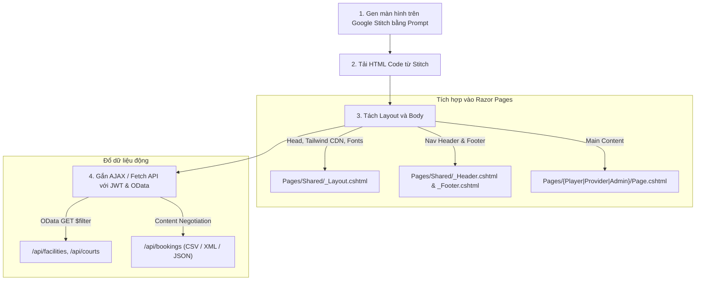

# TÀI LIỆU THIẾT KẾ UI/UX & PROMPT GENERATION (DOCUMENT 03)
**Dự án:** Hệ thống Đặt sân Cầu lông Đa nhà cung cấp (CourtSide - Badminton Booking Platform)  
**Môn học:** PRN232 - Building Cross-Platform Back-End Application With .NET  
**Nền tảng Thiết kế:** Google Stitch (Project ID: `5399800698562670953`) & ASP.NET Core Razor Pages

---

## 1. Design System & Brand Identity (Chuẩn hóa theo Google Stitch)

Mọi prompt và màn hình mới phải kế thừa 100% ngôn ngữ thiết kế đã định hình trên Google Stitch của dự án CourtSide:

### 1.1. Bảng màu (Color Palette - Material Design 3 Tone-based)
* **Primary (Chủ đạo):** `#00685f` (Teal thể thao cao cấp, nút CTA chính, active state).
* **Primary Container / Hover:** `#008378` / `#89f5e7` (Mint sáng làm điểm nhấn).
* **Secondary:** `#006b5f` / `#6df5e1` (Hỗ trợ nhãn tag, badge phụ).
* **Surface Background:** `#f8f9ff` (Xanh sáng dịu mắt, sạch sẽ, không dùng trắng tinh tuyệt đối).
* **Surface Container Lowest (Card / Box):** `#ffffff` (Nền các thẻ, bảng biểu, modal).
* **On Surface (Text chính):** `#0b1c30` (Navy đậm, độ tương phản cao, hiện đại).
* **On Surface Variant (Text phụ / Muted):** `#3d4947` / `#6d7a77` (Mô tả, địa chỉ, icon phụ).
* **Tertiary / Accent:** `#924628` / `#b05e3d` (Cam đất ấm dùng cho Đánh giá sao, giá tiền nổi bật, tag ưu đãi).
* **Error / Cảnh báo:** `#ba1a1a` / `#ffdad6` (Hủy đơn, sân bảo trì, nút xóa).

### 1.2. Typography & Iconography
* **Font Family:** `Inter`, sans-serif (Weights: 400, 500, 600, 700).
* **Icon Library:** `Material Symbols Outlined` (Google Fonts).
* **Bo góc (Border Radius):** 
  * Cards, Containers lớn: `rounded-2xl` (`16px`).
  * Buttons, Input fields, Badges: `rounded-xl` (`12px`) hoặc `rounded-full` cho search bars/avatars.
* **Đổ bóng (Shadow):** `shadow-lg shadow-on-surface/5` hoặc `shadow-xl shadow-surface-tint/5` (Đổ bóng mềm, mờ, không gắt).

---

## 2. Bảng Tổng Hợp Hiện Trạng Màn Hình (Screen Inventory)

| STT | Phân hệ | Tên màn hình | Trạng thái trên Stitch | Cần tạo mới |
| :---: | :---: | :--- | :---: | :---: |
| 1 | **Player** | Trang chủ (Desktop & Mobile) | ✅ Đã có | Không |
| 2 | **Player** | Danh sách sân & Tìm kiếm OData (Desktop & Mobile) | ✅ Đã có | Không |
| 3 | **Player** | Lịch đặt của tôi & Hủy sân (Desktop & Mobile) | ✅ Đã có | Không |
| 4 | **Player** | Ví CourtSide & Thông tin tài khoản | ✅ Đã có | Không |
| 5 | **Player** | **Chi tiết Cụm sân & Ma trận Đặt sân (Court $\times$ TimeSlot Matrix)** | ❌ Chưa có | **Prompt #1** |
| 6 | **Player** | **Thanh toán & Xác nhận Đơn đặt (Checkout & Booking Confirmation)** | ❌ Chưa có | **Prompt #2** |
| 7 | **Common** | **Đăng nhập & Đăng ký phân quyền (Auth - Login & Register)** | ❌ Chưa có | **Prompt #3** |
| 8 | **Provider** | **Quản lý Cơ sở của tôi (Facilities CRUD)** | ❌ Chưa có | **Prompt #4** |
| 9 | **Provider** | **Quản lý Sân con & Khung giờ giá (Courts & TimeSlots Config)** | ❌ Chưa có | **Prompt #5** |
| 10 | **Provider** | **Quản lý Đơn đặt & Xuất báo cáo CSV/XML/JSON** | ❌ Chưa có | **Prompt #6** |
| 11 | **Admin** | **Kiểm duyệt Cơ sở (Facility Approval & Moderation)** | ❌ Chưa có | **Prompt #7** |
| 12 | **Admin** | **Quản lý Người dùng toàn hệ thống (User Management)** | ❌ Chưa có | **Prompt #8** |

---

## 3. Bộ Prompt Chuẩn để Sinh Màn Hình Còn Thiếu (Google Stitch Ready)

> [!TIP]
> Bạn chỉ cần copy từng đoạn Prompt tiếng Anh bên dưới dán vào khung **Generate Screen** của Google Stitch. Các prompt đã được tinh chỉnh để tuân thủ chính xác bộ Design Tokens của CourtSide.

---

### Prompt #1: Player - Chi tiết Cụm sân & Ma trận Đặt sân (Facility Detail & Booking Matrix)

```text
Design a responsive Desktop screen for "CourtSide - Facility Detail & Live Court Booking Matrix".
Brand & Style:
- Top fixed navigation bar matching CourtSide design system (Logo "CourtSide" in deep teal #00685f, nav links, search bar, profile avatar).
- Modern athletic aesthetic, Inter font, Material Symbols Outlined, light background #f8f9ff.

Main Content Layout:
1. Facility Hero & Gallery:
   - Big showcase card with high-resolution badminton facility images, title "Cụm sân Sky Badminton Quận 7", rating badge 4.9 (240 reviews), address "79 Nguyễn Văn Linh, Tân Phú, Q.7, TP.HCM", operating hours "05:00 - 23:00", contact phone.
   - Amenities badges: "Thảm PVC chuẩn BWF", "Máy lạnh", "Wifi miễn phí", "Bãi đỗ xe ô tô", "Căng tin & Thuê vợt".
2. Interactive Booking Section:
   - Date picker toolbar (Horizontal scrollable days: "Hôm nay, 10/11", "Thứ Hai, 11/11", etc.).
   - Legend bar: "Trống (Có thể đặt) - Xanh lá", "Đang chọn - Teal đậm", "Đã có người đặt - Xám vô hiệu hóa", "Bảo trì - Cam".
   - The Core Booking Matrix (Grid Table):
     * Columns: Time slots (e.g. 06:00-07:00, 07:00-08:00, 17:00-18:00 (Peak), 18:00-19:00 (Peak), 19:00-20:00).
     * Rows: Sub-courts ("Sân 1 - Thảm PVC", "Sân 2 - Thảm PVC", "Sân 3 - Thảm Gỗ", "Sân 4 - Thảm PVC").
     * Cells: Show price tag (e.g., "90.000đ", "140.000đ") with click-to-select interaction state.
3. Sticky Bottom Booking Summary Bar:
   - Left: Selected items counter (e.g. "Đã chọn: Sân 2 (17:00 - 19:00) | Ngày: 10/11/2026").
   - Center: Total Price "280.000đ".
   - Right: "Tiến hành Đặt sân" (Proceed to Checkout) primary button with forward arrow icon.
```

---

### Prompt #2: Player - Thanh toán & Xác nhận Đơn đặt (Booking Checkout & Confirmation)

```text
Design a responsive Desktop checkout and confirmation screen for "CourtSide - Booking Checkout & Confirmation".
Brand & Style:
- Minimalist, trust-inspiring sports checkout layout using CourtSide color system (#00685f teal, #f8f9ff background, rounded-2xl white card containers).

Content Structure (2-Column Grid):
1. Left Column (Booking Details & Payment Methods):
   - Stepper: "1. Chọn sân -> 2. Thanh toán -> 3. Hoàn tất".
   - Booking Overview Card: Facility name, Court name, Play date, Time slot duration (2 hours), Player contact info form (Full Name, Phone number, Booking Notes).
   - Payment Option Selector:
     * Option A: "Ví CourtSide (Số dư: 1.250.000đ) - Khuyên dùng (Giảm 5%)".
     * Option B: "Chuyển khoản QR Code ngân hàng (VietQR / Napas247)".
     * Option C: "Thanh toán tại quầy sân".
2. Right Column (Order Summary & Instant Dynamic QR):
   - Sticky Order Summary Card:
     * Court fee: 280.000đ.
     * Service fee: 0đ.
     * Discount voucher input field with "Áp dụng" button.
     * Total amount: 280.000đ (Big prominent bold teal text).
   - VietQR Payment Box: Clean QR Code with bank logo, transfer description "COURTSIDE BK9823", countdown timer "Thời gian giữ chỗ: 09:45".
   - Primary action button: "Xác nhận đã chuyển khoản" / "Hoàn tất đặt lịch".
   - Safe booking guarantee badge with lock icon.
```

---

### Prompt #3: Common - Đăng nhập & Đăng ký phân quyền (Auth - Login & Register)

```text
Design an elegant, split-screen authentication page for "CourtSide - Login & Registration".
Brand & Style:
- Left Side (50% width on Desktop): Cinematic branding visual with dark teal overlay (#00201d to #00685f), featuring dynamic badminton athletes, headline "Nâng tầm trận đấu cùng CourtSide", bullet highlights of platform features.
- Right Side (50% width): Clean, white background #ffffff authentication form card.

Form Features:
1. Segmented Tab Switcher: "Đăng nhập" (Sign In) and "Đăng ký tài khoản" (Sign Up).
2. For Register Mode (Crucial for Multi-Provider platform):
   - Role Selection Radio Cards:
     * Card 1: "Người chơi (Player)" - Đặt sân, ghép trận, quản lý lịch chơi cá nhân.
     * Card 2: "Chủ sân (Provider)" - Đăng ký cơ sở, quản lý sân và doanh thu.
   - Input fields: Họ và tên, Email, Số điện thoại, Mật khẩu, Xác nhận mật khẩu.
3. For Login Mode:
   - Input fields: Email/Số điện thoại, Mật khẩu.
   - "Ghi nhớ đăng nhập" checkbox and "Quên mật khẩu?" link.
   - Primary submit button: "Đăng nhập vào CourtSide" in teal #00685f with hover transition.
4. Social sign-in options: "Tiếp tục với Google" button with official Google icon.
```

---

### Prompt #4: Provider - Quản lý Cơ sở của tôi (Facilities CRUD)

```text
Design a professional Desktop Management Dashboard screen for badminton facility owners: "CourtSide Provider - Quản lý Cơ sở Cầu lông".
Brand & Style:
- Provider layout with a sleek left sidebar navigation: Logo "CourtSide Partner", Nav items: "Tổng quan", "Cơ sở của tôi (Active)", "Sân & Khung giờ", "Đơn đặt sân", "Báo cáo doanh thu", "Cài đặt".
- Top bar with notifications, Provider profile, and quick "Thêm cơ sở mới" button.

Main Workspace Layout:
1. Quick KPI Cards (4 metrics):
   - "Tổng số cơ sở" (e.g. 3), "Tổng số sân con" (16), "Đơn đặt hôm nay" (48), "Doanh thu tháng" (64.500.000đ).
2. Facility Management Table & Filters:
   - OData Search & Filter Bar: Filter by Status dropdown ("Tất cả", "Approved - Đã duyệt", "Pending - Chờ duyệt", "Suspended - Tạm dừng"), search input by Facility Name or District.
   - High-density data table / card list:
     * Columns: Facility Thumbnail & Name, District/Address, Operating Hours, Sub-courts count, Status Badge (Green for Approved, Yellow for Pending, Red for Suspended), Actions.
     * Action Buttons: "Cấu hình Sân & Giá", "Chỉnh sửa thông tin", "Xóa cơ sở".
3. Slide-over Modal / Drawer for "Thêm / Sửa Cơ sở":
   - Fields: Tên cơ sở, Tỉnh/Thành phố, Quận/Huyện, Địa chỉ chi tiết, Số điện thoại liên hệ, Giờ mở cửa - Giờ đóng cửa, Mô tả tiện ích, Upload ảnh bìa.
   - Buttons: "Hủy" and "Lưu thông tin cơ sở".
```

---

### Prompt #5: Provider - Quản lý Sân con & Khung giờ giá (Courts & TimeSlots Config)

```text
Design a clean, dual-panel Desktop configuration screen: "CourtSide Provider - Quản lý Sân con & Khung giờ giá".
Brand & Style:
- Provider dashboard theme (#f8f9ff canvas, white #ffffff rounded-2xl panels, #00685f primary teal actions).
- Top header with Facility Switcher dropdown: "Đang quản lý: Cụm sân Sky Badminton Quận 7".

Two-Panel Interactive Layout:
1. Left Panel (Quản lý Sân con - Sub-Courts Management):
   - Header with "+ Thêm sân mới" button.
   - List of sub-courts (Sân 1, Sân 2, Sân 3...):
     * Court Name, Floor Type badge (PVC Carpet / Wooden Floor / Acrylic), Status toggle ("Hoạt động" vs "Đang bảo trì").
     * Quick edit and delete court actions.
2. Right Panel (Cấu hình Khung giờ & Bảng giá - TimeSlots & Pricing):
   - Header with "+ Thêm khung giờ" button and Quick template button ("Áp dụng khung giờ chuẩn").
   - Pricing slots table:
     * Slot Name (e.g. "Ca sáng sớm", "Ca tiêu chuẩn", "Ca vàng tối / Peak Hour").
     * Time Range (e.g. 05:00 - 08:00, 08:00 - 17:00, 17:00 - 22:00).
     * Price input with VNĐ formatting (e.g. 80.000đ, 100.000đ, 140.000đ).
     * Active switch toggle.
   - Visual Timeline bar preview at the bottom showing 24h distribution of court pricing.
```

---

### Prompt #6: Provider - Quản lý Đơn đặt & Xuất báo cáo CSV/XML/JSON

```text
Design a feature-rich Desktop booking management screen: "CourtSide Provider - Quản lý Đơn đặt sân & Xuất báo cáo".
Brand & Style:
- Consistent with CourtSide Provider portal design. Clean table layout with high readability.

Header & Content Negotiation Action Bar:
1. Top Toolbar with Content Negotiation Demo:
   - Prominent Export Button Group with download icons:
     * Button 1: "Xuất file CSV (Excel)" with green accent.
     * Button 2: "Xuất XML" with blue accent.
     * Button 3: "Xuất JSON (API Raw)" with dark gray accent.
2. OData Filter & Search Bar:
   - Filter by Date (Single date or Range), Filter by Court (Sân 1, Sân 2...), Filter by Status ("Tất cả", "Pending", "Confirmed", "Completed", "Cancelled").
3. Bookings Data Table:
   - Columns:
     * Mã đơn (Booking ID e.g. #BK-1092).
     * Khách hàng (Player Name & Phone number).
     * Sân & Khung giờ (e.g. Sân 2 | 18:00 - 19:00).
     * Ngày chơi (Play Date).
     * Tổng tiền (VNĐ).
     * Trạng thái (Pill badge with colored dots: Chờ xác nhận, Đã xác nhận, Hoàn tất, Đã hủy).
     * Thao tác: "Duyệt đơn", "Hủy đơn", "Xem chi tiết".
4. Pagination Footer with OData $top & $skip indicators: "Hiển thị 1-10 trên 148 đơn đặt", page numbers [1, 2, 3...], Next & Prev buttons.
```

---

### Prompt #7: Admin - Kiểm duyệt Cơ sở (Facility Approval & Moderation)

```text
Design a high-control Desktop Admin moderation screen: "CourtSide Admin - Kiểm duyệt Cơ sở Cầu lông".
Brand & Style:
- Admin command center aesthetic. Dark navy header banner (#0b1c30) with CourtSide Admin badge, main surface #f8f9ff.
- Sidebar menu: "Dashboard", "Kiểm duyệt cơ sở (Active - 5 chờ duyệt)", "Quản lý người dùng", "Cấu hình hệ thống".

Main Content Area:
1. Metric Counter Pills:
   - "Đang chờ duyệt: 5" (Highlighted in warning yellow).
   - "Đã phê duyệt: 124" (Green).
   - "Đã từ chối / Khóa: 8" (Red).
2. Pending Facilities Review Cards / Grid:
   - Each facility card shows:
     * Facility photos, Facility Name, Owner Name (Provider Info with email and phone verified badges).
     * Full Address, Business license preview modal button.
     * Operating hours, Number of sub-courts, Price range.
     * Date submitted (e.g. "Gửi yêu cầu 2 giờ trước").
   - Action Button Row:
     * Primary Green Button: "Phê duyệt (Approve)" with check icon.
     * Danger Red Button: "Từ chối (Reject)" with input for rejection reason.
     * Warning Button: "Yêu cầu bổ sung thông tin".
3. Approved Facilities Table below for historical audit and status revocation (Suspend button).
```

---

### Prompt #8: Admin - Quản lý Người dùng toàn hệ thống (User Management)

```text
Design a comprehensive Desktop Admin user management screen: "CourtSide Admin - Quản lý Tài khoản & Phân quyền".
Brand & Style:
- Professional Admin UI with table density controls, search by OData queries, role management badges.

Layout & Features:
1. Top Controls Bar:
   - Search bar: "Tìm kiếm theo Tên, Email, Số điện thoại...".
   - Role Filter Tabs: "Tất cả người dùng (1,420)", "Người chơi - Player (1,280)", "Chủ sân - Provider (135)", "Quản trị viên - Admin (5)".
   - Status Filter: "Hoạt động (Active)" vs "Đã khóa (Banned/Inactive)".
   - "+ Tạo tài khoản mới" primary button.
2. User Accounts Data Table:
   - Columns:
     * User (Avatar, Full Name, Email).
     * Số điện thoại.
     * Vai trò (Role badge: Admin in purple, Provider in teal, Player in blue).
     * Ngày tham gia (Created Date).
     * Trạng thái (Active switch toggle or Green/Gray badge).
     * Thao tác: "Đổi vai trò", "Khóa / Mở khóa tài khoản", "Đặt lại mật khẩu", "Xóa tài khoản".
3. Role Assignment Modal Dialog:
   - Edit User Role dropdown (Admin / Provider / Player).
   - Warning note about system permissions when changing to Admin.
   - Save and Cancel buttons.
```

---

## 4. Hướng dẫn Quy trình Ráp vào Dự án ASP.NET Core Razor Pages

Khi bạn gen các màn hình trên từ Google Stitch, quy trình chuyển đổi vào code dự án diễn ra theo 4 bước cực nhanh:



### Các bước thực hiện:
1. **Tạo trang `.cshtml` tương ứng:** 
   * Đặt file trong thư mục phân hệ (ví dụ: `Pages/Player/FacilityDetail.cshtml` hoặc `Pages/Provider/Bookings.cshtml`).
2. **Kế thừa Layout chung:**
   ```csharp
   @page
   @model FacilityDetailModel
   @{
       ViewData["Title"] = "Chi tiết cụm sân & Đặt lịch";
       Layout = "_Layout";
   }
   ```
3. **Bỏ phần `<header>` và `<footer>` (đã có trong `_Layout.cshtml`), chỉ dán thẻ `<main>` vào file:**
   * Toàn bộ class Tailwind CSS giữ nguyên vẹn 100%.
4. **Viết mã JavaScript gọi API:**
   * Thay thế dữ liệu mock trong bảng/thẻ card bằng vòng lặp JS `template literals` gọi từ endpoint ASP.NET Core Web API của bạn.
   * Đính kèm Header `Authorization: Bearer <token>` thông qua hàm dùng chung `callApi()` đã định nghĩa trong tài liệu kỹ thuật.

